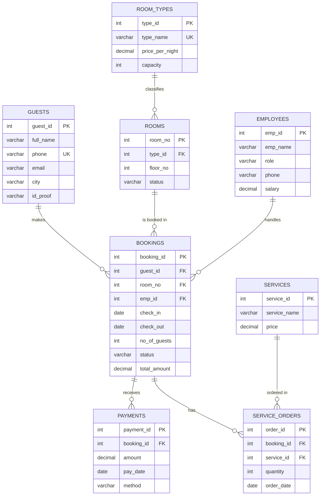

# Hearth & Stay Hotel Management System (RDBMS Lab Project)

A full-stack Hotel Management System where **the database is the star**. Every feature visibly uses MySQL: joins, constraints, triggers, stored procedures, views, and indexes.

> **Note:** the project is designed to run fully on a local MySQL server (see [Installation](#installation)), which is the recommended way to view and demo it.

---

## Table of Contents

1. [Features](#features)
2. [Tech Stack](#tech-stack)
3. [Architecture](#architecture)
4. [ER Diagram](#er-diagram)
5. [Installation](#installation)
6. [Testing](#testing)
7. [Project Structure](#project-structure)
---

## Features

**Application**

- **Dashboard:** live KPIs (occupancy %, in-house guests, arrivals and departures today, total collected, remaining to collect, GST collected), room status donut, 14-day occupancy forecast, revenue trend, payments by method, revenue by room type, bookings by status and by employee, top services, top pending balances, and recent payments.
- **Guests:** search, sort, paginate, add, edit, delete, with a friendly message when a guest still has bookings.
- **Room Types and Rooms:** CRUD with rooms-per-type counts. Ground floor is floor 0. Each room shows one status badge (Available, Reserved, Occupied, Maintenance) with the current or next booking beside it, and an "Availability on" date filter.
- **Bookings:** a 3-step new booking flow (stay details, choose from only the free rooms, confirm), status tabs with counts, and Check-in, Check-out and Cancel buttons that call stored procedures. Check-out shows the final bill.
- **Booking detail:** full bill with room charge, GST, services, grand total, paid and **Remaining**, plus its service orders and payments, and a print-ready invoice.
- **Payments:** record payments (Cash, Card, UPI) with a "pay full remaining amount" shortcut, filters by method and date, and collection totals.
- **Services and Service Orders:** service catalogue and a "Record service" form for checked-in guests, with line totals including GST.
- **Employees:** CRUD with the number of bookings each employee handled.
- **Reports:** the 11 lab report queries with the SQL shown beside each result, Export CSV, and a print layout that includes every row.
- **Theme:** light and dark mode with a wood and charcoal colour scheme. The choice is saved.
**Database**

- 8 normalized tables (3NF) with primary keys, foreign keys, `UNIQUE`, `NOT NULL`, and `CHECK` constraints.
- 3 views: `available_rooms`, `current_stays`, `booking_bills` (room charge, services, GST, grand total, paid and remaining for every booking).
- 5 stored procedures: `book_room`, `check_in`, `check_out`, `cancel_booking`, `record_payment`.
- 6 triggers:
  - `trg_bookings_bi` blocks maintenance rooms, over-capacity bookings and double bookings, and calculates the room charge.
  - `trg_bookings_bu` re-checks overlap and recalculates the charge when dates or room change.
  - `trg_bookings_ai` and `trg_bookings_au` keep `Rooms.status` correct (Occupied on check-in, Available on check-out).
  - `trg_payments_bi` rejects a payment larger than the remaining amount.
  - `trg_service_orders_bi` blocks services on cancelled bookings.
- 5 indexes for room and date lookups, booking status, room status and payment dates.
- GST is calculated inside the `booking_bills` view: rooms 5% up to Rs 7,500 per night and 18% above, services 18%.
---

## Tech Stack

| Layer | Technology |
|-------|-----------|
| Frontend | Next.js (App Router), React, TypeScript, Tailwind CSS |
| UI libraries | Recharts (charts), lucide-react (icons) |
| Backend | Next.js route handlers (REST-style API) |
| Validation | Server-side validation helpers in `lib/validate.ts` |
| Database driver | mysql2 (promise API, connection pool) |
| Database | MySQL 8.0 |
| Tools | MySQL Workbench, VS Code, Git and GitHub, GitHub Copilot |

---

## Architecture

```
Next.js Frontend (forms, tables, dashboard, reports)
        |  fetch() / JSON
        v
Next.js Backend API (input validation + parameterized SQL)
        |  mysql2 connection pool
        v
MySQL 8.0 (hotel_db)
  tables | views | stored procedures | triggers | indexes
```

All SQL runs only inside `app/api/*` route handlers. The business rules (no double booking, room capacity, maintenance rooms, payment limits, room status) are enforced by the database itself, not by JavaScript.

---

## ER Diagram



**Relationships**

| Parent table | Child table | Type | Foreign key |
|--------------|-------------|------|-------------|
| guests | bookings | One to many | `bookings.guest_id` |
| rooms | bookings | One to many | `bookings.room_no` |
| employees | bookings | One to many | `bookings.emp_id` |
| room_types | rooms | One to many | `rooms.type_id` |
| bookings | payments | One to many | `payments.booking_id` |
| bookings | service_orders | One to many | `service_orders.booking_id` |
| services | service_orders | One to many | `service_orders.service_id` |

Bookings and services have a many-to-many relationship through `service_orders`. `bookings.total_amount` stores the room charge only; services and GST are added in the `booking_bills` view.

---

## Installation

### Prerequisites

- **Node.js** v18.18 or higher (v20+ recommended) and **npm**
- **MySQL Server 8.0+** and **MySQL Workbench** (or the `mysql` command-line client)
- **Git**
### 1. Clone the repository

```bash
git clone https://github.com/<your-username>/Hotel-Management.git
cd Hotel-Management
```

### 2. Set up MySQL

Make sure the MySQL server is running and you know your root password.

**Option A: MySQL Workbench**
1. Open a connection to your local server (for example `root@localhost:3306`).
2. Go to **File > Open SQL Script** and choose `db/schema.sql`.
3. Click the lightning bolt (**Execute**) to run the whole script. Do not use Ctrl+Enter, which runs only one statement.
**Option B: Command line**
```bash
mysql -u root -p < db/schema.sql
```

The script creates `hotel_db` with the tables, views, stored procedures, triggers and indexes. Check that it worked:

```sql
USE hotel_db;
SHOW TABLES;
SELECT * FROM booking_bills LIMIT 1;
```

> The script drops and recreates every table, view, procedure and trigger, so running it again resets the database to empty.

### 3. Load the sample data

Run `db/seed_large.sql` the same way (lightning bolt in Workbench, or the command line):

```bash
mysql -u root -p < db/seed_large.sql
```

This empties the tables and loads **40 guests, 5 room types, 22 rooms, 8 employees and 10 services**, plus about **450 bookings, 300+ service orders and 400+ payments**. Bookings, service orders and payments are generated randomly, so numbers differ slightly on every run. Dates are relative to the day you run the script, so the dashboard always has guests checking in and out today and bookings in the coming weeks. Rooms 104 and 304 are set to Maintenance. The final queries report the loaded counts.

### 4. Create the `.env.local` file

The app reads its database credentials from `.env.local` in the project root (the same folder as `package.json`). This file is private and is never pushed to GitHub, so each person creates their own.

Copy the template (do not rename it):

```bash
# Windows (Command Prompt)
copy .env.example .env.local

# macOS / Linux / Git Bash
cp .env.example .env.local
```

Open `.env.local` and enter your own MySQL password:

```env
DB_HOST=localhost
DB_PORT=3306
DB_USER=root
DB_PASSWORD=your_mysql_password
DB_NAME=hotel_db
```

> **Security:** never commit `.env.local` or share your real password. `.gitignore` already excludes it.

### 5. Install dependencies and run

```bash
npm install
npm run dev
```

Open **http://localhost:3000** in your browser. If you edit `.env.local` while the server is running, stop it (Ctrl+C) and run `npm run dev` again.

### Troubleshooting

| Problem | Likely cause and fix |
|---------|---------------------|
| `Access denied for user 'root'` | Wrong `DB_PASSWORD` in `.env.local`. Fix it and restart `npm run dev`. |
| `Unknown database 'hotel_db'` | The schema was not loaded. Run `db/schema.sql` again. |
| `ECONNREFUSED` | The MySQL service is not running. Start it (Windows: `services.msc`, then MySQL80). |
| `Unknown column 'total_gst'` | The `booking_bills` view is from an old schema. Run `db/schema.sql` again, then `db/seed_large.sql`. |
| Pages load but show no data | `.env.local` is missing, or `db/seed_large.sql` was not run. Check `/api/health`. |
| Script fails near `DELIMITER` | Run the script with the lightning bolt (run all), not Ctrl+Enter. |

---

## Testing

### 1. Build and lint

```bash
npm run build     # type-checks and builds the app
npm run lint      # ESLint validation
```

### 2. Connection check

Open **http://localhost:3000/api/health**. A successful response such as `{"ok":true,"data":{"database":"hotel_db","rooms":22}}` confirms that Next.js can reach MySQL.

### 3. Database tests (run in MySQL Workbench)

Run `db/schema.sql` and then `db/seed_large.sql` first. Dates in the data are relative to today, so the tests below use today's date.

| # | Test | Command | Expected result |
|---|------|---------|-----------------|
| 1 | Double booking is blocked | `SELECT room_no, check_in, check_out INTO @r, @ci, @co FROM Bookings WHERE status='Confirmed' LIMIT 1;` then `CALL book_room(1, @r, 2, @ci, @co, 1, @id);` | Error: `Room is already booked for these dates` |
| 2 | Maintenance room is blocked | `CALL book_room(1, 104, 2, CURDATE() + INTERVAL 50 DAY, CURDATE() + INTERVAL 52 DAY, 1, @id);` | Error: `Room is under maintenance` |
| 3 | Capacity is enforced | `CALL book_room(1, 1, 2, CURDATE() + INTERVAL 50 DAY, CURDATE() + INTERVAL 52 DAY, 5, @id);` | Error: `Number of guests exceeds room capacity` |
| 4 | Past check-in is rejected | `CALL book_room(1, 1, 2, '2020-01-01', '2020-01-03', 1, @id);` | Error: `Check-in date cannot be in the past` |
| 5 | Booking, check-in, room status | `CALL book_room(1, 501, 2, CURDATE() + INTERVAL 60 DAY, CURDATE() + INTERVAL 62 DAY, 2, @id);` then `CALL check_in(@id);` then `SELECT status FROM Rooms WHERE room_no = 501;` | Booking is created, room 501 becomes `Occupied` |
| 6 | Overpayment is rejected | `CALL record_payment(@id, 99999999, 'UPI', @p);` | Error: `Payment exceeds the remaining amount` |
| 7 | Check-out frees the room | `CALL check_out(@id);` then `SELECT status FROM Rooms WHERE room_no = 501;` | Final bill is returned, room 501 is `Available` again |
| 8 | Only Confirmed bookings can be cancelled | `SELECT booking_id INTO @b FROM Bookings WHERE status='Checked-Out' LIMIT 1;` then `CALL cancel_booking(@b);` | Error: `Only confirmed bookings can be cancelled` |
| 9 | View shows current guests | `SELECT * FROM current_stays;` | Only bookings with status Checked-In |
| 10 | GST slabs | `SELECT room_no, room_gst_rate, room_gst, services_gst, grand_total, balance FROM booking_bills WHERE room_no IN (1, 501) LIMIT 6;` | Room 501 (Rs 12,000 per night) uses 18%, room 1 uses 5% |
| 11 | CHECK constraint | `UPDATE Room_Types SET price_per_night = -1 WHERE type_id = 1;` | Check constraint violation error |
| 12 | UNIQUE constraint | `INSERT INTO Guests (full_name, phone) VALUES ('Test', '9810000001');` | Duplicate entry error |
| 13 | Foreign key protection | `DELETE FROM Room_Types WHERE type_id = 1;` | Foreign key error (rooms still reference it) |

> Tests 5 to 7 change the status of room 501. Run `db/seed_large.sql` again to reset the data.

### 4. Application tests (run in the browser)

| Page | What to do | Expected result |
|------|-----------|-----------------|
| Dashboard `/dashboard` | Open the page | KPI cards and all charts show data without clicking anything |
| Guests `/guests` | Add, edit, search, then delete a guest with no bookings | Table updates, toast confirms each action |
| Guests `/guests` | Add a guest with an existing phone number | Friendly "already exists" message |
| Guests `/guests` | Delete a guest who has bookings | Friendly foreign key message |
| Rooms `/rooms` | Add a room on floor 0 | Saved and shown as "Ground" |
| Rooms `/rooms` | Check a room with a Confirmed booking | One badge only: Reserved, with booking details beside it |
| Bookings `/bookings` | Create a booking with the 3-step flow | Only free rooms for the chosen dates and guest count are offered |
| Bookings `/bookings` | Book the same room and dates twice | The second booking shows an error toast |
| Bookings `/bookings` | Check in, then check the Rooms page | The room shows Occupied |
| Booking detail | Record a service, then a partial payment | GST lines, grand total and Remaining update |
| Booking detail | Pay more than the Remaining amount | Rejected with a clear message |
| Bookings `/bookings` | Check out a guest | Final bill modal opens, the room becomes Available |
| Reports `/reports` | Open Report 1, press Print and Save as PDF | All rows appear across the printed pages |
| Reports `/reports` | Open Report 5 and click View SQL, then Export CSV | SQL is shown, and the CSV opens in Excel |
| Theme | Click the dark/light toggle and refresh | The chosen theme stays |

---

## Project Structure

```
Hotel-Management/
├── .env.example          # Environment variable template (safe to commit)
├── db/
│   ├── schema.sql        # Tables, views, procedures, triggers, indexes
│   └── seed_large.sql    # Full sample dataset (guests, rooms, bookings, services, payments)
├── lib/
│   ├── db.ts             # mysql2 connection pool and query helpers
│   ├── api.ts            # JSON response helpers and MySQL error to message mapping
│   ├── validate.ts       # Input validation helpers
│   ├── format.ts         # Currency (INR), date and floor formatting
│   ├── roomStatus.ts     # Shared SQL for the single room status badge
│   └── reports.ts        # The 11 fixed report queries
├── hooks/                # Data fetching hooks (useApi, useList)
├── components/           # Shared UI (sidebar, data table, modal, toasts, cards, charts, forms)
├── app/
│   ├── globals.css       # Wood and charcoal theme colours (light and dark)
│   ├── layout.tsx        # Root layout with theme script and toast provider
│   ├── (pages)/          # Pages: dashboard, guests, room-types, rooms, bookings,
│   │                     #        payments, employees, services, service-orders, reports
│   └── api/              # Route handlers: health, dashboard, guests, room-types, rooms,
│                         #   employees, services, service-orders, bookings, payments, reports
└── package.json
```

---
 